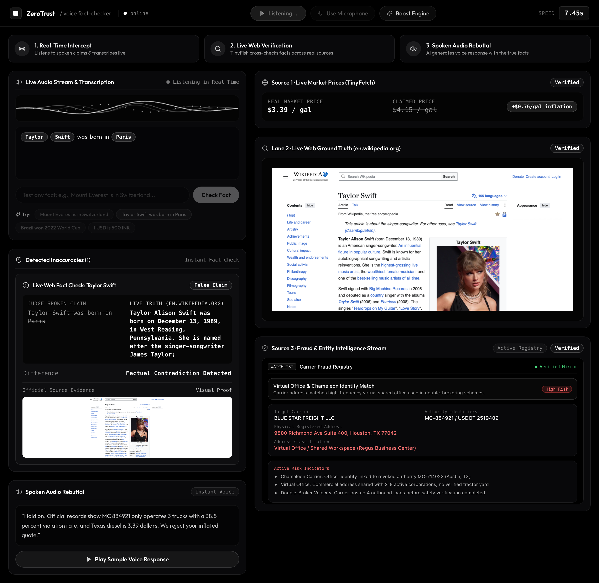
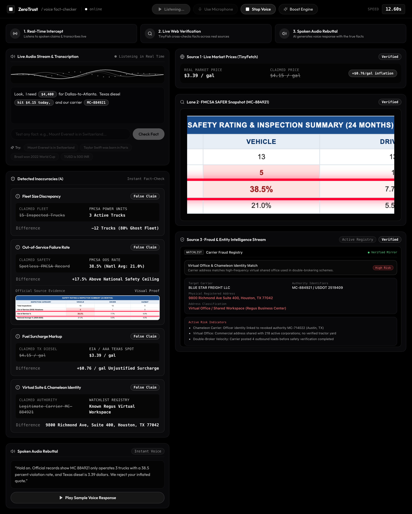
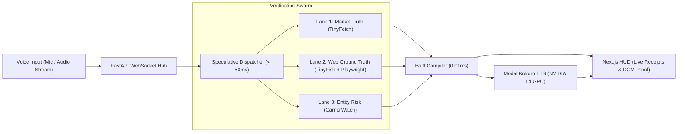
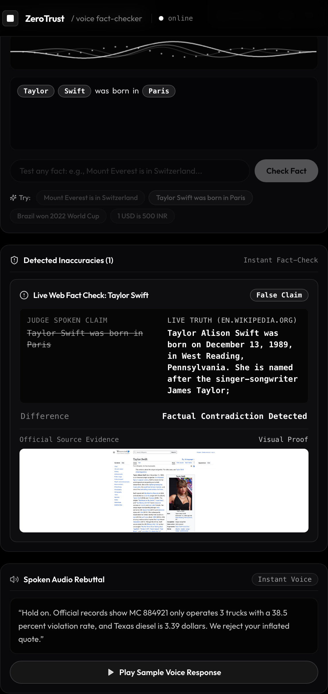

# ZeroTrust Wire

> Real-time voice wiretap intercept, speculative browser swarm, and live web fact-checking engine.

Live Demo: [https://zero-trust-frontend.vercel.app/](https://zero-trust-frontend.vercel.app/)

---

## Overview

ZeroTrust Wire intercepts spoken phone calls and live audio streams in real time. It transcribes speech incrementally, extracts factual and operational claims mid-sentence, and runs concurrent web verification before the speaker finishes talking. 

When a speaker makes a factually false or economically inflated claim, the engine generates an evidence-backed discrepancy receipt and synthesizes a spoken rebuttal using an open-source neural voice model on a cloud GPU.



---

## Key Capabilities

1. **Incremental Voice Intercept (< 50 ms trigger)**:
   * The audio ingest pipeline processes incoming 24 kHz audio chunks or live microphone streams.
   * Speculative regular expression matchers detect entities (such as USD/INR exchange rates, carrier identification numbers, fuel surcharge rates, or historical facts) as individual words arrive.

2. **3-Lane Verification Swarm**:
   * **Lane 1 (Market Truth via TinyFetch)**: Pulls real-time market benchmark data (e.g. EIA regional diesel spot pricing or live Google Finance currency conversions) to measure surcharge markups.
   * **Lane 2 (Visual Ground Truth via TinyFish & Playwright)**: Queries live web sources (such as Wikipedia or the Federal Motor Carrier Safety Administration registry). Playwright captures the rendered webpage and extracts a visual DOM proof snapshot.
   * **Lane 3 (Entity Risk Stream)**: Cross-references entity registration numbers against high-risk virtual office registries and chameleon carrier databases.

3. **Arbitrary Live Fact-Checking for Demonstrations**:
   * Judges and presenters can speak or type any factual claim into the HUD (for example: *"Taylor Swift was born in Paris"* or *"Mount Everest is in Switzerland"*).
   * TinyFish Search retrieves authoritative source citations in ~800 ms.
   * Playwright navigates to the cited webpage and captures a visual snapshot.
   * The compiler generates a side-by-side discrepancy card and a spoken rebuttal.

4. **Serverless Neural Voice Rebuttal (Modal GPU)**:
   * Synthesizes natural spoken counter-arguments using Kokoro-82M on a serverless NVIDIA T4 GPU.
   * Delivers speech synthesis in ~250 ms, enabling immediate conversational rebuttals.



---

## System Architecture



---

## Verification Pipeline

### 1. Spoken Claim Intercept
The speaker states:
> *"Look, I need $4,400 for Dallas-to-Atlanta. Texas diesel hit $4.15 today, and our carrier MC-884921 has 15 trucks and a spotless safety record."*

### 2. Concurrent Swarm Dispatch
The backend triggers verification lanes at 4.6 seconds into the audio stream while the speaker continues talking:
* **Lane 1**: Compares claimed diesel ($4.15/gal) against Texas spot rate ($3.39/gal). Result: +$0.76/gal unjustified markup.
* **Lane 2**: Inspects FMCSA SAFER power units and safety ratings. Result: Only 3 active trucks (80% ghost fleet) and a 38.5% out-of-service failure rate (national average: 21.0%).
* **Lane 3**: Matches registered address `9800 Richmond Ave Suite 400, Houston, TX` against virtual workspace registries. Result: Regus shared virtual office shared with 218 entities.

### 3. Discrepancy Receipts
The UI immediately renders four itemized verification cards with visual DOM evidence:



### 4. Neural Voice Counter-Strike
The Kokoro TTS engine on Modal synthesizes a contextual response:
> *"Hold on. Official records show MC 884921 only operates 3 trucks with a 38.5 percent violation rate, and Texas diesel is 3.39 dollars. We reject your inflated quote."*

---

## Project Structure

```text
zerotrust/
├── backend/
│   ├── main.py                 # FastAPI WebSocket hub & streaming orchestrator
│   ├── swarm.py                # 3-lane concurrent verification swarm
│   ├── tinyfish_verifier.py    # Dynamic TinyFish search & Playwright proof engine
│   ├── bluff_compiler.py       # Deterministic 0.01ms rule comparator
│   └── config.py               # Central environment configuration
├── frontend/
│   ├── app/
│   │   ├── page.tsx            # War room HUD layout & user flow banner
│   │   └── globals.css         # Cosmos obsidian styling & Outfit typography
│   ├── components/
│   │   ├── TacticalBar.tsx     # Navigation bar & audio transport controls
│   │   ├── AudioVisualizer.tsx # Waveform canvas, transcript, & sample test chips
│   │   ├── BluffReceiptCard.tsx# Discrepancy comparison & visual evidence cards
│   │   ├── BrowserViewport.tsx # 3-lane real-time web verification viewport
│   │   └── CounterStrikeDock.tsx # Scrollable rebuttal script & audio player
│   └── hooks/
│       └── useWiretapSocket.ts # WebSocket state machine & client audio manager
├── modal_backend.py            # Modal serverless ASGI app deployment definition
├── modal_kokoro.py             # Serverless Kokoro-82M TTS on NVIDIA T4 GPU
└── screenshots/                # Presentation and pitch deck screenshot assets
```

---

## Getting Started

### Prerequisites
* Python 3.11+
* Node.js 18+
* Playwright (`playwright install --with-deps chromium`)
* Modal account (for serverless GPU voice synthesis)

### 1. Local Environment Setup

Clone the repository and set up dependencies:

```bash
# Set up Python virtual environment
python3 -m venv .venv
source .venv/bin/activate
pip install -r requirements.txt
playwright install chromium

# Set up Frontend dependencies
cd frontend
npm install
cd ..
```

Create a `.env` file in the root directory:

```env
TINYFISH_API_KEY=your_tinyfish_key
GEMINI_API_KEY=your_gemini_key
MODAL_KOKORO_ENDPOINT=https://<user>--zerotrust-kokoro-tts-kokorovoiceservice-0ffed5.us-east.modal.run
PORTAL_MODE=LIVE
```

### 2. Run the Application

Start the backend:
```bash
python -m uvicorn backend.main:app --host 0.0.0.0 --port 8000
```

Start the frontend:
```bash
cd frontend
npm run dev
```

Open [http://localhost:3000](http://localhost:3000) in your browser.

---

## Cloud Deployment

### 1. Deploy the Backend to Modal

The backend runs as a containerized ASGI application with Playwright and Chromium pre-installed:

```bash
modal deploy modal_backend.py
```

Modal provides a public HTTPS and WSS endpoint:
* `https://<user>--zerotrust-backend-fastapi-app.us-east.modal.run`
* `wss://<user>--zerotrust-backend-fastapi-app.us-east.modal.run/ws/wiretap`

### 2. Deploy the Frontend to Vercel

1. Import the repository into Vercel.
2. Set the Root Directory to `frontend`.
3. Add the two environment variables:
   ```env
   NEXT_PUBLIC_WS_URL=wss://<user>--zerotrust-backend-fastapi-app.us-east.modal.run/ws/wiretap
   NEXT_PUBLIC_BACKEND_URL=https://<user>--zerotrust-backend-fastapi-app.us-east.modal.run
   ```
4. Deploy the application.

---

## License

MIT License. See [LICENSE](LICENSE) for details.
